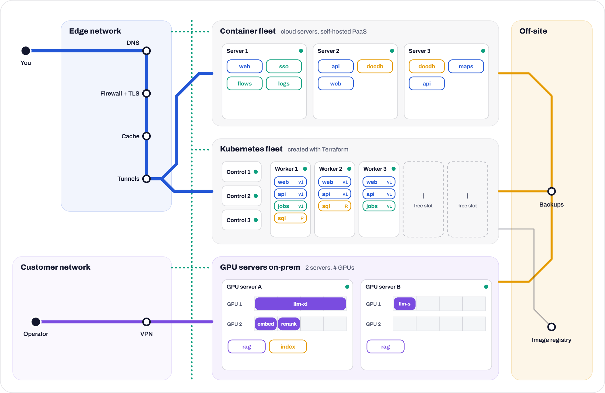

<h1 align="center">Daniele Greco</h1>

  <b>Powering mission-critical infrastructure for aviation and modern industry</b>

  <a href="https://danielegreco.com">Website</a> ·
  <a href="https://danielegreco.com/linkedin">LinkedIn</a> ·
  <a href="mailto:info@danielegreco.com?subject=Quote%20request">Ask for a quote</a>

**PhD** student with several years of experience as a system architect and software engineer, based in Bergamo, Italy.
I build and manage all kinds of clusters, **from on-premise server rooms to cloud-native environments**,
following the **highest security** standards.

  <a href="https://danielegreco.com/#demo"><b>Play with the demo</b></a>: switch servers off, ship a release, ask the AI assistant.

## Experience

**System architect**, [flAi](https://github.com/flAi-S-R-L) · 2026 – now 
flAi builds decision-support tools for aviation and mobility. I run the platform underneath:
GPU servers on-prem, cloud fleets, single sign-on, backups and monitoring.

**Freelance software engineer** · 2026 – now 
Software design, development and technical consulting, as an independent professional.

**Undergraduate research fellow**, University of Bergamo · Jul – Nov 2025 
Research for MOST, the Italian National Center for Sustainable Mobility, about transport modes and user behaviour.
I ran a market analysis of the Italian e-bike sector that went into the project's deliverables.

**CPM consultant**, Avvale · 2023 – 2024 
Modules for OneStream, a corporate performance management platform, written in Visual Basic and .NET.

## Studies

**PhD in Technology, Innovation and Management**, University of Bergamo · from Nov 2026 
Research on using generative AI to solve optimisation problems.

**MSc in Computer Engineering**, University of Bergamo · 2023 – 2026 
Thesis with Prof. Angelo Gargantini: [HaiSIM](https://github.com/DaniGreco/hai-sim), a simulator of a radiology reading room
with an AI in it, to study how AI changes waiting times and the radiologists' decisions.

**BSc in Computer Science and Engineering**, University of Bergamo · 2019 – 2023 
Thesis with Prof. Paolo Malighetti: [a web scraper](https://github.com/DaniGreco/ebike-market-analysis) in JavaScript, Node.js and Docker
that collects e-bike components from Italian shops.

---

The same content lives on <a href="https://danielegreco.com">danielegreco.com</a>. Source code of the site: <a href="https://github.com/DaniGreco/website">DaniGreco/website</a>.
